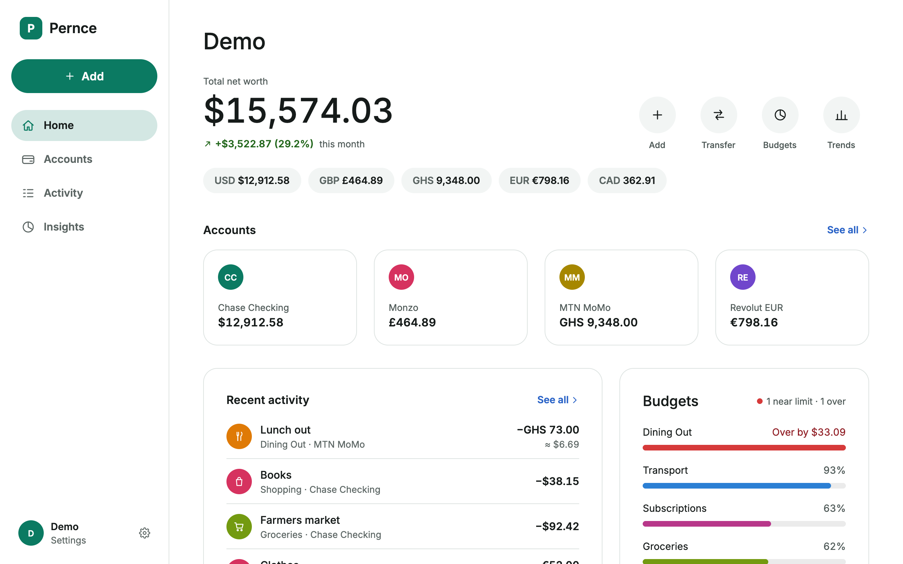
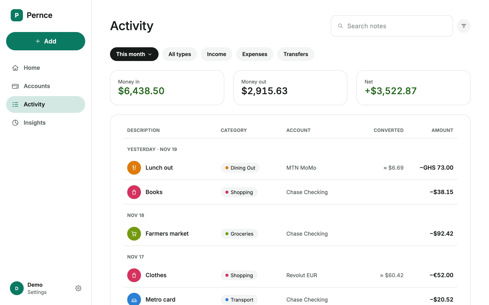
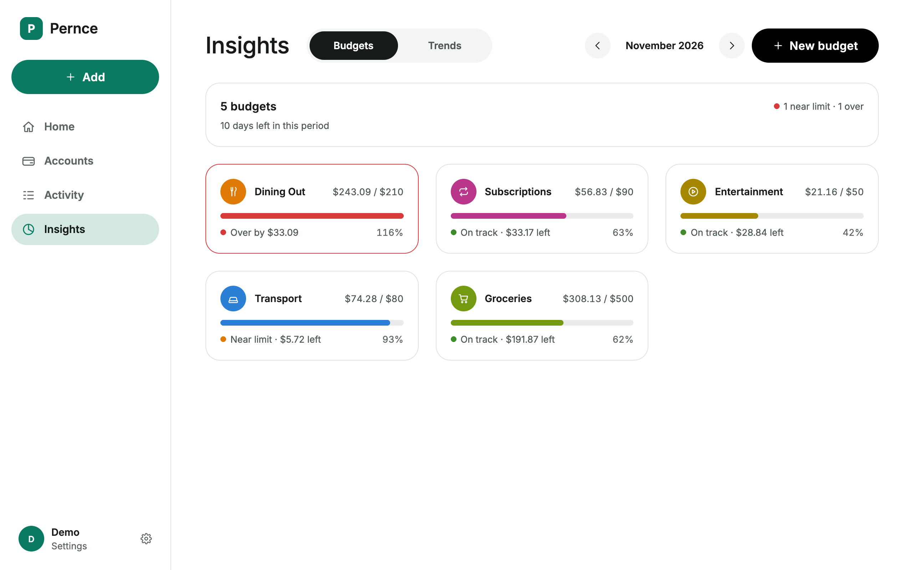
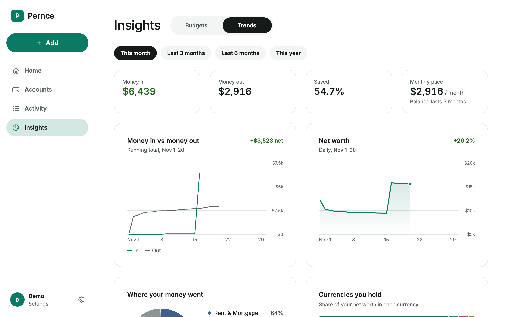
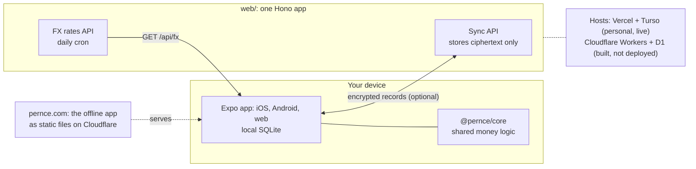

# Pernce

A multi-currency, offline-first personal finance tracker. Free and open source (Apache-2.0).

<!-- badges: enable once CI is green (see docs/launch-checklist.md)
[](https://github.com/kofiad/pernce/actions/workflows/ci.yml)
[](LICENSE)
[](https://github.com/kofiad/pernce/releases)
-->

<picture>
  <source media="(prefers-color-scheme: dark)" srcset="docs/screenshots/home-dark.png">
  
</picture>

<p>
  
  
  
</p>

<sub>Screenshots use made-up demo data ([`docs/demo/`](docs/demo/), [`docs/screenshots/`](docs/screenshots/)).</sub>

## Try it

Open **<https://pernce.com>** and choose "Get started". No sign-up: the app
runs entirely in your browser, your data stays in that browser, and you can
export a backup at any time. It also installs as an app from the browser
(on iPhone: Share, then Add to Home Screen).

The iOS and Android apps come from the same Expo code; build a dev build as
described in [`mobile/README.md`](mobile/README.md).

## Why I built this

I'm a Forward Deployed Engineer and I travel between countries for work. I
hold money in several currencies across wallets and bank accounts, and I
needed one place to track all of it, set budgets and see where my money
goes. I couldn't find anything free and open source that fit, so I built it.
I've used it daily since September 2026.

## Features

- About 150 ISO 4217 currencies, with net worth in your base currency
- Daily exchange rates, plus manual rates when you want your own
- Money stored as integer minor units, never floats
- Accounts of any kind, including mobile money
- Income, expenses and transfers, including cross-currency transfers with fees
- Budgets, analytics and spending trends
- CSV and JSON backup, import and export
- English and French, light and dark themes
- Optional end-to-end encrypted sync between devices: the server only ever
  sees ciphertext (personal build for now; held back from the store build)
- One Expo codebase for iOS, Android and the web

## How it's put together



- `core/` (`@pernce/core`): framework-free money logic (currencies,
  formatting, CSV, balances, reports) shared by the app and the server.
- `mobile/` (`@pernce/mobile`): the offline-first Expo app for iOS, Android
  and the web. Everything lives in a local SQLite database; balances are
  derived from the ledger.
- `web/` (`@pernce/web`): one Hono app serving the sync API, public FX rates
  and the crons. It stores only ciphertext for sync, and on Vercel also
  hosts the personal web app.

## Developer quick start

```bash
pnpm install                                  # core + web (pnpm only)
pnpm test                                     # core tests
cd mobile && pnpm install && pnpm expo start --web
```

You need Node 22 and pnpm. More in [`docs/development.md`](docs/development.md) (server setup, checks,
project structure), [`mobile/README.md`](mobile/README.md) and
[`web/AGENTS.md`](web/AGENTS.md).

## Docs

| Topic | Where |
|---|---|
| Design system | [`docs/design/`](docs/design/) |
| Sync design | [`docs/sync.md`](docs/sync.md) |
| Deployment | [`docs/deployment.md`](docs/deployment.md), [`docs/web-deployment.md`](docs/web-deployment.md) |
| Development | [`docs/development.md`](docs/development.md) |
| Mobile app | [`mobile/README.md`](mobile/README.md) |
| Release notes | [`CHANGELOG.md`](CHANGELOG.md) |

## Built with Claude Code

I built Pernce while learning Claude Code. The repo's
[`CLAUDE.md`](CLAUDE.md), [`web/AGENTS.md`](web/AGENTS.md) and
[`mobile/AGENTS.md`](mobile/AGENTS.md) are the instructions the agent worked from, so they double as a record of the
project's conventions and rules.
How that went, what went wrong and what I'd do differently:
[`docs/built-with-claude-code.md`](docs/built-with-claude-code.md).

## Contributing

Contributions are welcome: see [CONTRIBUTING.md](CONTRIBUTING.md) for setup,
checks and the rules reviews look for, and the
[Code of Conduct](CODE_OF_CONDUCT.md).

## Security

Please don't open a public issue for a vulnerability. Report security problems privately as described in [SECURITY.md](SECURITY.md).

## License

Copyright 2026 Gilbert A. Henyo and Pernce contributors.

Pernce is licensed under the [Apache License 2.0](LICENSE); see also
[NOTICE](NOTICE). The Pernce name, logo and app icon are not covered by the
license: if you publish your own build, give it a different name and icon
(see [TRADEMARKS.md](TRADEMARKS.md)).
